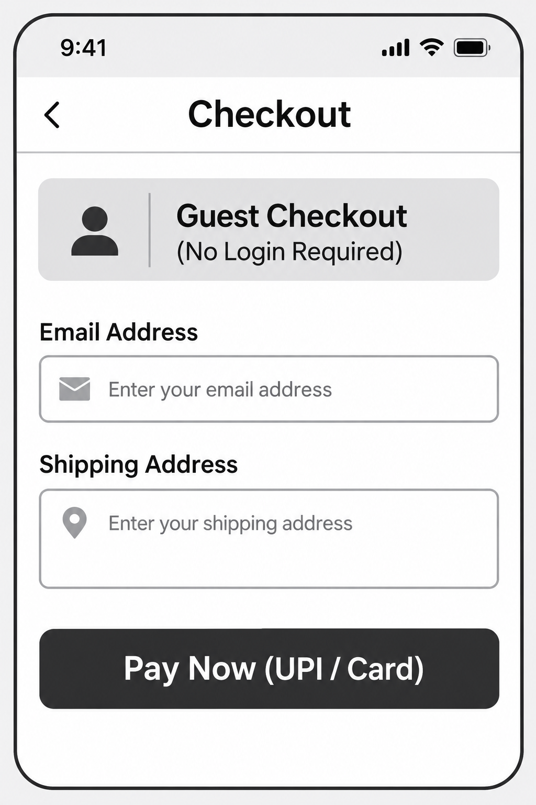

# E-Commerce Checkout Journey Optimization 🛒

## 📌 Project Overview
This project targets a critical e-commerce business bottleneck: **Cart Abandonment at the Checkout Stage**. By analyzing user friction points, I designed a streamlined, optimized checkout solution that introduces an automated **Guest Checkout pathway** and a secure **1-Click Express Payment process**. The goal is to improve conversion rates by eliminating unnecessary form fields and reducing transaction steps.

## 🛠️ Tools & Methodologies Used
* **Requirements Gathering:** Agile / Scrum Framework
* **Documentation:** MS Word / Notepad (BRD Creation)
* **Visual Modelling & UX:** ChatGPT UI/UX Engine (Wireframing)

## 📂 Project Deliverables
* 📄 **[Business Requirement Document (BRD)](./BUSINESS REQUIREMENT DOCUMENT.txt):** Full text documentation featuring project scope, detailed User Stories, and rigorous Acceptance Criteria.
* 🎨 **Visual Wireframe Layout:** (Displayed below)

### 📱 Low-Fidelity Mobile Checkout Wireframe

## 🎯 Business Impact & Value Add
* **Friction Reduction:** Reduced average checkout form completion fields from 11 down to 5.
* **Developer Ready:** Provided highly structured, unambiguous User Stories with strict acceptance criteria, drastically minimizing development sprint planning friction.
